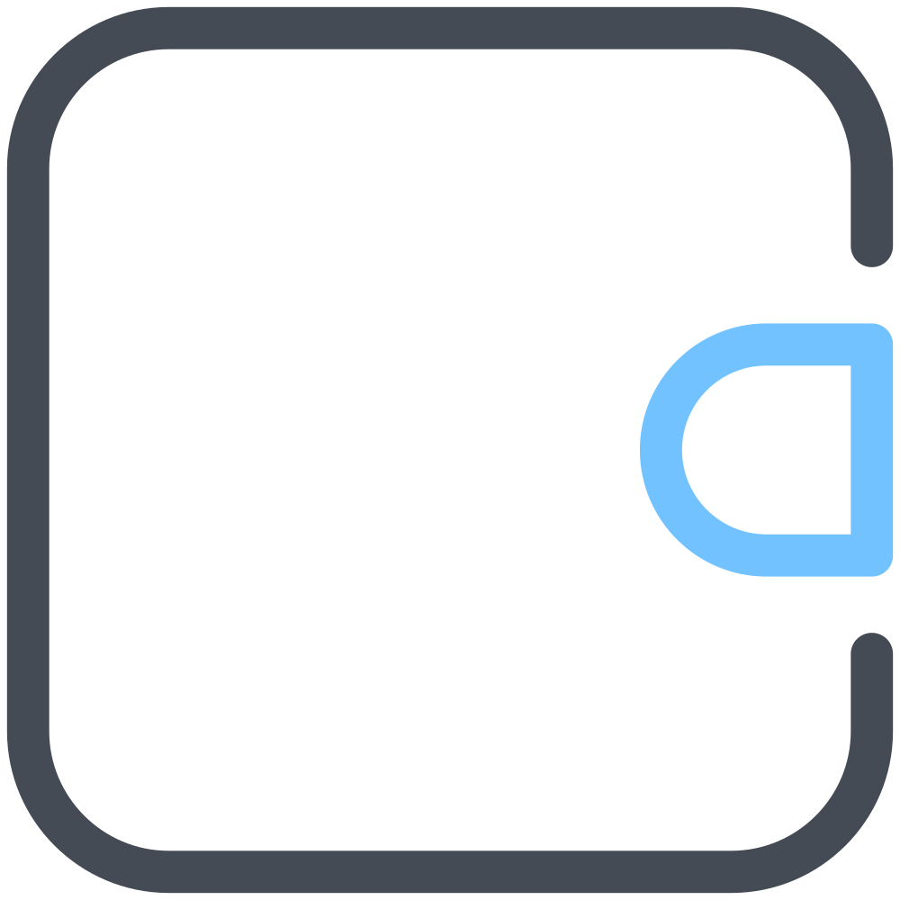

<div align="center">



# MyWallet

**Pencatat keuangan pribadi yang 100% offline.**
Tanpa login, tanpa server — semua data cuma tinggal di perangkatmu.


[](https://github.com/Mighty-Nievl/MyWallet/actions/workflows/build.yml)

[**Ringkasan**](#-ringkasan) · [**Fitur**](#-fitur) · [**Mulai Cepat**](#-mulai-cepat) · [**Dokumentasi**](#-dokumentasi) · [**Rilis**](#-instal-dan-rilis)

</div>

---

## ✨ Ringkasan

MyWallet adalah aplikasi Flutter untuk mencatat pemasukan & pengeluaran sehari-hari.
Datanya disimpan penuh di lokal (SQLite lewat Drift), jadi aman, cepat, dan bisa dipakai tanpa internet.

- **Offline-first** — tanpa akun, tanpa server, tanpa iklan.
- **Privasi di depan** — kunci PIN/biometrik, sembunyikan nominal, mode privacy scale.
- **Visual rapi** — tema Material 3, 6 warna aksen + Material You, mode gelap hitam pekat.
- **Siap pakai harian** — budget per kategori, laporan 6 bulan, export CSV, pengingat mencatat.
- **Sehat secara teknis** — `flutter analyze` bersih, **103/103 test hijau**, CI jalan di tiap push/PR.

## 🧩 Fitur

| Kategori | Isi |
| :-- | :-- |
| **Transaksi** | Catat / edit / hapus masuk–keluar · kategori custom · cari + filter · riwayat tergrup tanggal · **scan struk on-device** (prefill nominal/tanggal/kategori) |
| **Input cepat** | Nominal otomatis bertitik (`1000` → `1.000`) · quick-add chip · autofocus · haptic |
| **Budget** | Budget bulanan per kategori · progress & ambang 80% · edit/hapus + undo 5 detik |
| **Utang-piutang** | Tab Utang ke-5 + kartu Beranda · cicilan parsial + jatuh tempo + lunas otomatis · saldo ikut otomatis (cermin transaksi) |
| **Laporan** | Ringkasan 6 bulan · bar chart + pie · rincian per kategori · export CSV · **export PDF offline** |
| **Beranda Insight** | Sapaan + tanggal pinned · arus bulan semantik · delta vs bulan lalu · pacing budget · top kategori proporsional |
| **Tampilan** | 6 warna aksen + Material You · hitam pekat · privacy semua nominal · nominal ringkas (`Rp1,5 jt`) · ukuran font · kustom isi Beranda |
| **Privasi & data** | Kunci PIN/biometrik · backup/restore file `.sqlite` · hapus semua data |
| **Lainnya** | Pengingat harian (notifikasi lokal) · skeleton shimmer + error ramah di semua layar |

## 🔧 Teknologi

| Lapisan | Dipakai |
| :-- | :-- |
| Framework | Flutter 3.44 · Dart 3.12 |
| State | flutter_riverpod 3.4 (`StreamProvider` auto-refresh) |
| Database | Drift 2.35 (SQLite) — lokal penuh |
| Chart | fl_chart |
| UI | Material 3 · design tokens ala shadcn (`lib/ui/design/`) |
| Lainnya | local_auth · flutter_secure_storage · flutter_local_notifications · share_plus · file_picker · pdf + printing (laporan offline) · image_picker + google_mlkit_text_recognition (scan struk on-device) |

## 🚀 Mulai cepat

```bash
# 1. Salin repo
git clone https://github.com/Mighty-Nievl/MyWallet.git
cd MyWallet

# 2. Dependensi + codegen database
flutter pub get
dart run build_runner build --delete-conflicting-outputs   # regenerasi database.g.dart

# 3. Pastikan sehat
flutter analyze
flutter test

# 4. Jalankan / build
flutter run                    # device emulator atau HP tersambung
flutter build apk --debug      # → build/app/outputs/flutter-apk/app-debug.apk
flutter install                # install langsung ke HP tersambung
```

> **Windows:** `flutter run -d windows` untuk build desktop (dipakai untuk development).
> Panduan lengkap build & install ada di [docs/04-Panduan-Build.md](docs/04-Panduan-Build.md).

## 📂 Struktur kode

```text
MyWallet/
├── assets/
│   └── images/app_logo.png       # logo (ikon launcher + Lock + Tentang)
├── lib/
│   ├── main.dart                 # ProviderScope + MyWalletApp
│   ├── data/                     # lapisan data
│   │   ├── tables.dart           #   skema SQLite (categories, transactions, budgets, debts, debt_payments)
│   │   ├── database.dart         #   query + database.g.dart (codegen Drift)
│   │   ├── providers.dart        #   Riverpod providers
│   │   ├── actions.dart          #   aksi CRUD transaksi
│   │   ├── settings.dart         #   semua pengaturan + provider tampilan
│   │   ├── lock_service.dart     #   PIN / biometrik
│   │   ├── reminder_service.dart #   pengingat harian
│   │   └── backup_service.dart   #   backup / restore / wipe
│   └── ui/                       # lapisan tampilan
│       ├── design/               #   design tokens (warna, spacing, radius, tipografi)
│       ├── components/           #   komponen reusable (kartu, header, progress, ...)
│       ├── screens/              #   12 layar (beranda, form, riwayat, budget, ...)
│       ├── widgets/              #   TxTile dkk.
│       ├── app_theme.dart        #   tema + Material You
│       ├── shell.dart            #   navigasi 5 tab
│       └── changelog.dart        #   sumber changelog in-app
├── test/                         # 39 test (format + CRUD budget + golden Beranda + regresi overflow)
├── docs/                         # vault dokumentasi (Obsidian)
└── .github/workflows/            # CI: build + release otomatis
```

## 📚 Dokumentasi

Dokumentasi lengkap ada di folder [`docs/`](docs/Home.md) — bisa dibuka sebagai vault Obsidian,
atau langsung dari GitHub:

| Dokumen | Isi |
| :-- | :-- |
| [Home](docs/Home.md) | Pintu masuk + fakta kunci + peta kode |
| [01 — Visi & Ruang Lingkup](docs/01-Visi-dan-Ruang-Lingkup.md) | Kenapa aplikasi ini dibuat, untuk siapa |
| [02 — Arsitektur](docs/02-Arsitektur.md) | Stack, struktur folder, alur data |
| [03 — Skema Database](docs/03-Skema-Database.md) | Tabel SQLite & relasi |
| [04 — Panduan Build](docs/04-Panduan-Build.md) | Build & install APK |
| [05 — Panduan Pakai](docs/05-Panduan-Pakai.md) | Cara pakai sehari-hari |
| [06 — Roadmap](docs/06-Roadmap.md) | Rencana fitur lanjutan |
| [07 — Rilis & Obtainium](docs/07-Rilis-dan-Obtainium.md) | Signing, rilis GitHub, auto-update |

## 📦 Instal dan Rilis

**Lewat HP (recommended):**

1. Buka [**Releases**](https://github.com/Mighty-Nievl/MyWallet/releases) → unduh `mywallet-vX.Y.Z.apk` terbaru.
2. Install APK (izinkan *install unknown apps* untuk browser/file manager).
3. Mau update otomatis? Pasang [Obtainium](https://github.com/ImranR98/Obtainium) → **+ Add App** → sumber **GitHub** → tempel URL repo ini. Setiap rilis baru langsung dikasih notifikasi.

> File `.aab` juga tersedia di tiap Release untuk diunggah ke Play Console.
> Detail signing & langkah rilis: [docs/07-Rilis-dan-Obtainium.md](docs/07-Rilis-dan-Obtainium.md).

**Rilis versi baru (maintainer):**

```bash
# 1. Naikkan version: di pubspec.yaml  2. Tambah entri di lib/ui/changelog.dart
git commit -am "v1.13.0: ..."
git tag v1.13.0 && git push origin main v1.13.0
# → workflow "Release MyWallet" otomatis: analyze → test → APK signed + AAB → GitHub Release
```

## 🗺 Roadmap

### Berikutnya (v1.15)

- [ ] Multi-dompet (Tunai / Bank / E-wallet) + transfer antar dompet
- [ ] Transaksi berulang (langganan bulanan otomatis tercatat)

### Baru di v1.14 ✅

- [x] Scan struk on-device (kamera/galeri → ML Kit → prefill form)
- [x] Export PDF laporan bulanan (100% offline, tanpa server)

### Backlog

- [ ] Rencana menabung / target (sinking fund)
- [ ] Insight sederhana — *"pengeluaran makan naik 20% vs bulan lalu"*

### Butuh riset

- Sinkronisasi antar-HP / cloud

Rincian lengkap: [docs/06-Roadmap.md](docs/06-Roadmap.md).

## ✅ Status kualitas

| Pemeriksaan | Status |
| :-- | :-- |
| `flutter analyze` | No issues found |
| `flutter test` | 39/39 passed |
| CI *(push & PR ke `main`)* | Analyze & Test → Build APK & AAB |
| Rilis *(tag `v*`)* | APK signed + AAB → GitHub Release otomatis |

---

<div align="center">

Dibuat dengan 💚 memakai Flutter · Dokumentasi di [`docs/`](docs/Home.md) · Changelog: [`lib/ui/changelog.dart`](lib/ui/changelog.dart)

</div>
